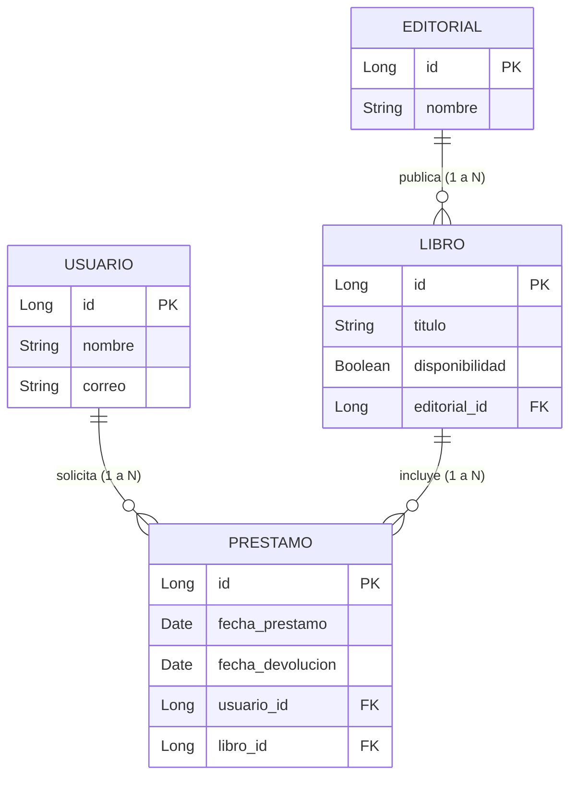

# API REST de administración de biblioteca

Proyecto de la materia Implementación de Sistemas.

## 1. Descripción general del proyecto

Se desarrollará una API REST con Java y Spring Boot para administrar
una biblioteca.

El sistema permitirá registrar, consultar, actualizar y eliminar
información de tres entidades:

- Libro: información de los libros y su disponibilidad.
- Usuario: información de las personas que solicitan préstamos.
- Préstamo: relación entre un usuario y un libro, con fechas de
  préstamo y devolución.

El proyecto incluirá documentación con Swagger UI, pruebas unitarias
y configuración para ejecutarse en un contenedor GNU/Linux.

El código se administrará en GitHub con una rama principal llamada
main y una rama por integrante.

## 2. Integrantes del equipo
| Nombre completo |
|---|
Cabanzo Torres Carlos
Camal García Diego Alejandro
García Nuñez Axel Alfonso
Salas Loaeza Itzel Guadalupe 

## 3. Primeros cinco requerimientos

| ID | Requerimiento | Criterio de aceptación |
|---|---|---|
| RF01 |El sistema permitirá al usuario registrar, consultar, actualizar y eliminar libros.| Las cuatro operaciones funcionan y permiten identificar cada libro por su ID. |
| RF02 | Registrar, consultar, actualizar y eliminar usuarios. | Las cuatro operaciones funcionan y no se permiten correos duplicados. |
| RF03 | Registrar, consultar, actualizar y eliminar préstamos. | Cada préstamo se relaciona con un libro y un usuario existentes. |
| RF04 | Validar la disponibilidad de los libros. | No se permite prestar un libro que ya tiene un préstamo activo. |
| RF05 | Registrar devoluciones. | Al devolver un libro, el préstamo finaliza y el libro vuelve a estar disponible. |

## 3.1. Modelo Entidad-Relación y Relaciones 1 a Muchos

A continuación se muestra el diagrama que representa las relaciones de uno a muchos (1:N) implementadas mediante colecciones de objetos en el proyecto:

## 4. Funcionalidades que pueden resolverse con paquetes

| Funcionalidad | Paquete o herramienta | Uso previsto |
|---|---|---|
| Endpoints REST | Spring Web | Procesar solicitudes HTTP. |
| Persistencia en base de datos | Spring Data JPA y controlador JDBC de MySQL | Guardar y consultar información. |
| Validación | Spring Boot Validation | Validar campos obligatorios y correos. |
| Autenticación y seguridad | Spring Security | Controlar el acceso, si se incorpora esta funcionalidad. |
| Logs | SLF4J y Logback | Registrar eventos y errores. |
| Documentación | springdoc-openapi y Swagger UI | Documentar y probar los endpoints. |
| Pruebas unitarias | JUnit y Mockito | Verificar el comportamiento de la aplicación. |

