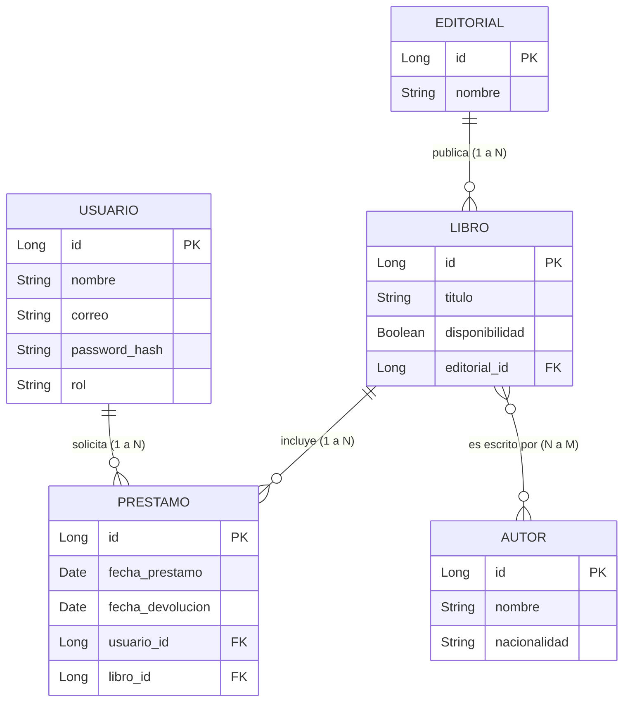
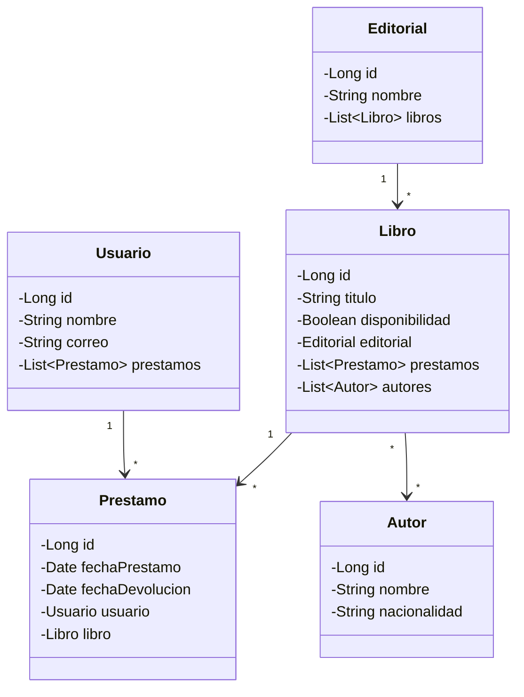

# API REST de administración de biblioteca

Proyecto de la materia Implementación de Sistemas.

## 1. Descripción general del proyecto

Es una API REST hecha con Java y Spring Boot para administrar una
biblioteca. Permite registrar libros, llevar el control de los
usuarios y registrar los préstamos y devoluciones, validando que un
libro no se preste dos veces al mismo tiempo.

El sistema permite registrar, consultar, actualizar y eliminar
información de las siguientes entidades:

- **Libro:** datos del libro y su disponibilidad.
- **Usuario:** personas que solicitan préstamos y que inician sesión.
- **Préstamo:** relación entre un usuario y un libro, con fechas de
  préstamo y devolución.
- **Editorial:** casa editorial que publica los libros.
- **Autor:** persona que escribe uno o varios libros.

El proyecto está construido con Spring Boot y usa sus paquetes para
seguridad, persistencia, validación, documentación, logs y pruebas.
El código se administra en GitHub con una rama principal llamada
`main` y una rama por integrante.

## 2. Integrantes del equipo

| Nombre completo |
|---|
| Cabanzo Torres Carlos |
| Camal García Diego Alejandro |
| García Nuñez Axel Alfonso |
| Salas Loaeza Itzel Guadalupe |

## 3. Requerimientos (primeros 5)

| ID | Requerimiento | Descripción | Criterio de aceptación |
|---|---|---|---|
| RF01 | Gestión de libros | Registrar, consultar, actualizar y eliminar libros. | Las cuatro operaciones funcionan y cada libro se identifica por su ID. |
| RF02 | Gestión de usuarios | Registrar, consultar, actualizar y eliminar usuarios. | Las cuatro operaciones funcionan y no se permiten correos duplicados. |
| RF03 | Gestión de préstamos | Registrar, consultar, actualizar y eliminar préstamos. | Cada préstamo se relaciona con un libro y un usuario existentes. |
| RF04 | Disponibilidad de libros | Validar si un libro se puede prestar. | No se permite prestar un libro que ya tiene un préstamo activo. |
| RF05 | Devoluciones | Registrar la devolución de un libro. | Al devolver, el préstamo finaliza y el libro vuelve a estar disponible. |

## 4. Arquitectura

La API está organizada en capas. Cada capa tiene una sola
responsabilidad:

```text
Cliente (Postman / Swagger / front-end)
        │  HTTP + JSON
        ▼
Controller   → recibe la petición y responde (@RestController)
        ▼
Repository   → acceso a datos (Spring Data JPA)
        ▼
Base de datos (MySQL)
```

### Estructura de paquetes

```text
com.biblioteca
├── config/        → seguridad, Swagger (OpenApiConfig)
├── controller/    → LibroController, UsuarioController, PrestamoController,
│                    EditorialController, AutorController, AuthController
├── repository/    → interfaces JPA de cada entidad
├── models/        → entidades JPA (Libro, Usuario, Prestamo, Editorial, Autor)
└── security/      → JwtService, JwtFilter
```

### Entidades principales

| Entidad | Campos clave | Relaciones |
|---|---|---|
| Editorial | id, nombre | Una editorial tiene muchos libros |
| Autor | id, nombre, nacionalidad | Un autor aparece en muchos libros (muchos a muchos) |
| Libro | id, título, disponibilidad | Pertenece a una editorial; tiene muchos préstamos y muchos autores |
| Usuario | id, nombre, correo, contraseña (hash), rol | Un usuario tiene muchos préstamos |
| Préstamo | id, fecha de préstamo, fecha de devolución | Pertenece a un usuario y a un libro |

### Endpoints principales

| Método | Ruta | Función | Acceso |
|---|---|---|---|
| POST | `/api/auth/registro` | Registrar usuario | Público |
| POST | `/api/auth/login` | Iniciar sesión y obtener el JWT | Público |
| GET | `/api/libros` | Listar libros | Con token |
| GET | `/api/libros/{id}` | Detalle de un libro | Con token |
| POST, PUT, DELETE | `/api/libros` | Gestionar libros | Con token |
| GET, POST, PUT, DELETE | `/api/usuarios` | Gestionar usuarios | Con token |
| GET, POST, PUT, DELETE | `/api/prestamos` | Gestionar préstamos | Con token |
| GET, POST, PUT, DELETE | `/api/editoriales` | Catálogo de editoriales | Con token |
| GET, POST, PUT, DELETE | `/api/autores` | Catálogo de autores | Con token |

## 5. Funcionalidades que pueden resolverse con paquetes de Spring Boot

| Funcionalidad | Paquete o starter |
|---|---|
| API REST | `spring-boot-starter-web` |
| Conexión a base de datos y ORM | `spring-boot-starter-data-jpa` + controlador JDBC de MySQL |
| Validación (campos obligatorios, correo válido) | `spring-boot-starter-validation` |
| Autenticación y roles | `spring-boot-starter-security` + JJWT |
| Logs | SLF4J + Logback (incluido por defecto) |
| Documentación de la API | `springdoc-openapi` (Swagger UI) |
| Pruebas unitarias y de integración | `spring-boot-starter-test` (JUnit y Mockito) |
| Reducir código repetitivo en los modelos | Lombok |

## 6. Funcionalidades necesarias para que la API funcione

**Imprescindibles**

- **Autenticación y autorización:** contraseñas con BCrypt e inicio de
  sesión con JWT.
- **Persistencia:** entidades JPA con relaciones correctas y
  restricciones únicas (por ejemplo, el correo del usuario).
- **Validación de entrada:** campos obligatorios y correo válido.
- **Regla de disponibilidad:** no prestar un libro con préstamo activo.
- **Manejo de errores:** respuestas claras (400, 401, 403, 404, 409).

**Importantes**

- Documentación con Swagger UI para probar sin Postman.
- Logs de eventos relevantes: registro, login fallido y errores.
- Pruebas unitarias.

## 7. Catálogos del administrador

Para el dashboard del administrador elegimos las entidades que
funcionan como catálogos. Para considerarlas catálogo pedimos dos
cosas:

1. No tienen llaves foráneas ni objetos de otra clase dentro de ellas.
2. Solo tienen propiedades, sin métodos de lógica.

Las entidades que cumplen son **Editorial**, **Autor** y **Usuario**.
Libro y Préstamo se quedaron fuera porque dependen de otras tablas.

| Operación | Método HTTP | Editorial | Autor | Usuario |
|---|---|---|---|---|
| Consultar todos | GET | `/api/editoriales` | `/api/autores` | `/api/usuarios` |
| Consultar uno | GET | `/api/editoriales/{id}` | `/api/autores/{id}` | `/api/usuarios/{id}` |
| Alta | POST | `/api/editoriales` | `/api/autores` | `/api/usuarios` |
| Cambio | PUT | `/api/editoriales/{id}` | `/api/autores/{id}` | `/api/usuarios/{id}` |
| Baja | DELETE | `/api/editoriales/{id}` | `/api/autores/{id}` | `/api/usuarios/{id}` |

## 8. Documentación de relaciones (parte 4)

### Relaciones 1 a muchos identificadas en el proyecto

- **Editorial a libros (Editorial 1 : N Libro):** una editorial
  contiene una colección de libros (`List<Libro> libros`), mientras
  que cada libro apunta a su editorial con la llave foránea
  `editorial_id`.
- **Usuario a préstamos (Usuario 1 : N Prestamo):** un usuario contiene
  una colección de préstamos (`List<Prestamo> prestamos`), y cada
  préstamo guarda `usuario_id`.
- **Libro a préstamos (Libro 1 : N Prestamo):** un libro contiene una
  colección de préstamos (`List<Prestamo> prestamos`), y cada préstamo
  guarda `libro_id`.

Ejemplo de cómo quedó en el código:

```java
// Editorial.java (lado "uno")
@OneToMany(mappedBy = "editorial", cascade = CascadeType.ALL)
@JsonManagedReference
private List<Libro> libros = new ArrayList<>();

// Libro.java (lado "muchos")
@ManyToOne
@JoinColumn(name = "editorial_id")
@JsonBackReference
private Editorial editorial;
```

Usamos `@JsonManagedReference` y `@JsonBackReference` para que al
convertir a JSON no se genere un ciclo infinito entre los objetos.

### Diagrama entidad-relación de la base de datos



### Diagrama de clases y colecciones de objetos



## 9. Documentación de Swagger, muchos a muchos y JWT (proyecto API final)

Cambios realizados en la rama `feature/swagger-jwt`.

### 9.1. Swagger / OpenAPI

- Se agregó la dependencia `springdoc-openapi-starter-webmvc-ui`.
- La documentación interactiva está en
  `http://localhost:8080/swagger-ui/index.html` y el contrato en
  `/v3/api-docs`.
- Permite consultar y probar todos los controladores de la API.
- Se creó `config/OpenApiConfig.java`: define el servidor como `/`
  para que "Try it out" funcione en Codespaces y registra el esquema
  `bearerAuth`, que habilita el botón **Authorize** para enviar el
  token JWT.

```xml
<dependency>
    <groupId>org.springdoc</groupId>
    <artifactId>springdoc-openapi-starter-webmvc-ui</artifactId>
    <version>2.8.9</version>
</dependency>
```

### 9.2. Lombok

- Se agregó Lombok para generar getters y setters en los modelos con
  `@Getter` y `@Setter`.
- Se configuró `annotationProcessorPaths` en `maven-compiler-plugin`.
  Desde Java 23 el compilador ya no ejecuta los procesadores de
  anotaciones por defecto, y sin esto los getters y setters no se
  generaban.

### 9.3. Relación muchos a muchos

Relación **Libro ↔ Autor**: un libro puede tener varios autores y un
autor puede escribir varios libros. Hibernate crea la tabla
intermedia `libro_autor` (`libro_id`, `autor_id`).

```java
// Libro.java
@ManyToMany
@JoinTable(
    name = "libro_autor",
    joinColumns = @JoinColumn(name = "libro_id"),
    inverseJoinColumns = @JoinColumn(name = "autor_id")
)
private List<Autor> autores = new ArrayList<>();
```

La relación es unidireccional: solo Libro conoce a sus autores. Así
Autor se queda como catálogo simple, sin referencias a otras clases.

| Método | Ruta | Función |
|---|---|---|
| GET | `/api/libros/{libroId}/autores` | Ver los autores de un libro |
| POST | `/api/libros/{libroId}/autores/{autorId}` | Asociar un autor a un libro |
| DELETE | `/api/libros/{libroId}/autores/{autorId}` | Quitar un autor de un libro |

### 9.4. Autenticación JWT

- Dependencias: `spring-boot-starter-security` y JJWT (`jjwt-api`,
  `jjwt-impl`, `jjwt-jackson`).
- Configuración en `application.properties`: `jwt.secret` (mínimo 32
  caracteres, se puede definir con la variable de entorno
  `JWT_SECRET`) y `jwt.expiration-ms` (3600000, una hora).
- Archivos nuevos:
  - `security/JwtService.java`: genera el token y extrae el correo.
  - `security/JwtFilter.java`: lee el encabezado
    `Authorization: Bearer <token>` e identifica al usuario en cada
    petición.
  - `config/SecurityConfig.java`: reglas de acceso, sesión sin estado
    y cifrado BCrypt.
  - `controller/AuthController.java`: registro e inicio de sesión.
- Las contraseñas se guardan con BCrypt, nunca en texto plano.

| Ruta | Método | Acceso |
|---|---|---|
| `/api/auth/registro` | POST | Público |
| `/api/auth/login` | POST | Público (devuelve el JWT) |
| `/swagger-ui/**` y `/v3/api-docs/**` | GET | Público |
| Cualquier otra ruta de `/api/**` | Todos | Usuario con token |

**Uso en Swagger:** registrar con `POST /api/auth/registro`, iniciar
sesión con `POST /api/auth/login`, copiar el token y pegarlo en el
botón **Authorize**. Sin token, las rutas protegidas responden 401 o
403.

### 9.5. Opcionales

- Repositorio del sitio web: _pendiente (agregar enlace)_
- Presentación de la API: _pendiente (agregar enlace)_

## 10. Plan de trabajo

1. **Base:** proyecto con hello world, devcontainer y conexión a MySQL.
2. **Modelo y repositorios:** entidades, repositorios y controladores
   de Libro, Usuario y Préstamo (RF01 a RF03).
3. **Reglas de negocio:** disponibilidad y devoluciones (RF04 y RF05).
4. **Catálogos del administrador:** Editorial, Autor y Usuario con
   altas, bajas, cambios y consultas.
5. **Relaciones:** uno a muchos y muchos a muchos, con diagramas.
6. **Cierre:** Swagger, JWT, pruebas y README final.

## 11. Cómo ejecutar

1. Abrir el repositorio en VS Code o Codespaces.
2. Configurar la conexión a MySQL en `application.properties`.
3. Definir la variable de entorno `JWT_SECRET` (o dejar la que viene
   en `application.properties` para desarrollo).
4. Ejecutar `./mvnw spring-boot:run`.
5. Abrir Swagger en `http://localhost:8080/swagger-ui/index.html`.

## 12. Problemas encontrados y soluciones

| Problema | Causa | Solución |
|---|---|---|
| `package lombok does not exist` | Faltaba la dependencia en el `pom.xml` | Agregar Lombok |
| `cannot find symbol` en `getId()`, `setNombre()`, etc. | Java 25 no ejecuta Lombok sin configuración | Configurar `annotationProcessorPaths` |
| `Connection refused` a la base de datos | El servidor de MySQL no estaba encendido | Levantar la base de datos antes de correr la API |
| `Failed to fetch` al probar en Swagger | Swagger llamaba a `localhost:8080` y desde el navegador ese host no es el Codespace | Definir el servidor como `/` en `OpenApiConfig` |
| `class X is public, should be declared in a file named X.java` | El nombre del archivo no coincide con el de la clase | Renombrar el archivo |
| Error de recursión infinita al devolver JSON | Las relaciones bidireccionales se referenciaban entre sí | Usar `@JsonManagedReference` y `@JsonBackReference` |