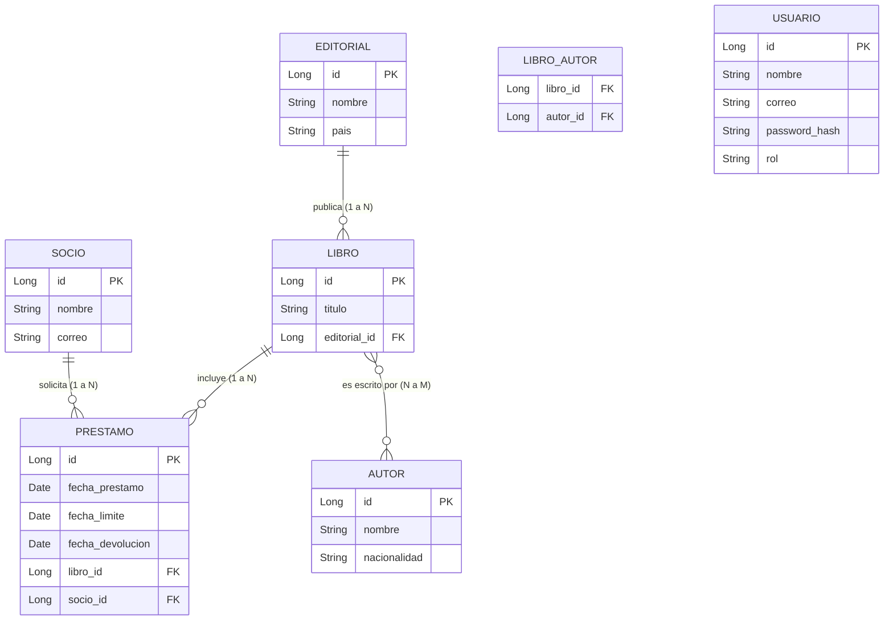
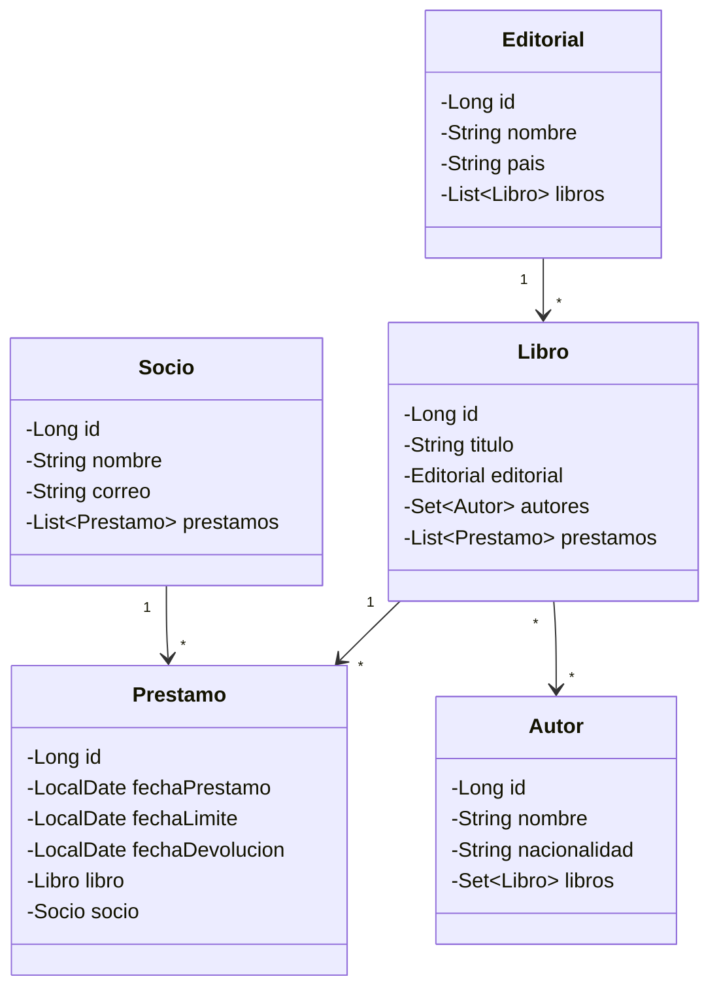

# API REST de administración de biblioteca

Proyecto de la materia Implementación de Sistemas.

## 1. Descripción general del proyecto

Es una API REST hecha con Java y Spring Boot para administrar una
biblioteca. Permite registrar libros, llevar el control de los socios
y registrar los préstamos y devoluciones, validando que un libro no se
preste dos veces al mismo tiempo. Incluye un front-end (BookSpace) que
consume la API.

El sistema permite registrar, consultar, actualizar y eliminar
información de las siguientes entidades:

- **Libro:** datos del libro, su editorial y sus autores.
- **Socio:** personas que solicitan libros prestados.
- **Préstamo:** relación entre un socio y un libro, con fecha de
  préstamo, fecha límite y fecha de devolución.
- **Editorial:** casa editorial que publica los libros.
- **Autor:** persona que escribe uno o varios libros.
- **Usuario:** bibliotecario o administrador que inicia sesión en el
  sistema (con contraseña cifrada y JWT).

El proyecto está construido con Spring Boot y usa sus paquetes para
seguridad, persistencia, documentación, logs y pruebas. El código se
administra en GitHub con una rama principal llamada `main` y ramas
`feature/*` que se integran con pull requests.

## 2. Integrantes del equipo

| Nombre completo |
|---|
| Cabanzo Torres Carlos |
| Camal García Diego Alejandro |
| García Nuñez Axel Alfonso |
| Salas Loaeza Itzel Guadalupe |

## 3. Requerimientos (primeros 5)

| ID | Requerimiento | Descripción | Criterio de aceptación |
|---|---|---|---|
| RF01 | Gestión de libros | Registrar, consultar, actualizar y eliminar libros. | Las cuatro operaciones funcionan y cada libro se identifica por su ID. |
| RF02 | Gestión de socios | Registrar, consultar, actualizar y eliminar socios. | Las cuatro operaciones funcionan y no se permiten correos duplicados. |
| RF03 | Gestión de préstamos | Registrar, consultar y eliminar préstamos. | Cada préstamo se relaciona con un libro y un socio existentes. |
| RF04 | Disponibilidad de libros | Validar si un libro se puede prestar. | No se permite prestar un libro que ya tiene un préstamo activo. |
| RF05 | Devoluciones | Registrar la devolución de un libro. | Al devolver, el préstamo finaliza y el libro vuelve a estar disponible. |

## 4. Arquitectura

La API está organizada en capas. Cada capa tiene una sola
responsabilidad:

```text
Cliente (BookSpace / Swagger / Postman)
        │  HTTP + JSON  (Authorization: Bearer <token>)
        ▼
JwtAuthenticationFilter → valida el token en cada petición
        ▼
Controller   → recibe la petición y responde (@RestController)
        ▼
Repository   → acceso a datos (Spring Data JPA)
        ▼
Base de datos (H2 en memoria)
```

### Estructura de paquetes

```text
com.biblioteca.api
├── config/        → OpenApiConfig (Swagger), GlobalExceptionHandler,
│                    DataInitializer (datos de ejemplo)
├── controllers/   → LibroController, SocioController, PrestamoController,
│                    EditorialController, AutorController, AuthController
├── dto/           → LibroRequest, PrestamoRequest, LoginRequest,
│                    RegistroRequest, AuthResponse
├── models/        → entidades JPA (Libro, Socio, Prestamo, Editorial, Autor, Usuario)
├── repositories/  → interfaces JPA de cada entidad
└── security/      → SecurityConfig, JwtTokenProvider, JwtAuthenticationFilter
biblioteca-frontend/ → sitio web BookSpace (HTML, CSS y JavaScript)
```

### Entidades principales

| Entidad | Campos clave | Relaciones |
|---|---|---|
| Editorial | id, nombre, país | Una editorial tiene muchos libros |
| Autor | id, nombre, nacionalidad | Un autor aparece en muchos libros (muchos a muchos) |
| Libro | id, título | Pertenece a una editorial; tiene muchos préstamos y muchos autores |
| Socio | id, nombre, correo | Un socio tiene muchos préstamos |
| Préstamo | id, fecha de préstamo, fecha límite, fecha de devolución | Pertenece a un socio y a un libro |
| Usuario | id, nombre, correo, contraseña (hash), rol | Inicia sesión; no se relaciona con otras tablas |

### Endpoints principales

| Método | Ruta | Función | Acceso |
|---|---|---|---|
| POST | `/api/auth/registro` | Registrar usuario | Público |
| POST | `/api/auth/login` | Iniciar sesión y obtener el JWT | Público |
| GET, POST | `/api/libros` | Listar y registrar libros | Con token |
| GET, PUT, DELETE | `/api/libros/{id}` | Consultar, editar y borrar un libro | Con token |
| GET | `/api/libros/{id}/autores` | Autores de un libro | Con token |
| POST, DELETE | `/api/libros/{id}/autores/{autorId}` | Asociar o quitar un autor | Con token |
| GET, POST | `/api/socios` | Listar y registrar socios | Con token |
| GET, PUT, DELETE | `/api/socios/{id}` | Consultar, editar y borrar un socio | Con token |
| GET, POST | `/api/prestamos` | Listar y registrar préstamos | Con token |
| GET, DELETE | `/api/prestamos/{id}` | Consultar y borrar un préstamo | Con token |
| PUT | `/api/prestamos/{id}/devolver` | Registrar la devolución | Con token |
| GET, POST, PUT, DELETE | `/api/editoriales` | Catálogo de editoriales | Con token |
| GET, POST, PUT, DELETE | `/api/autores` | Catálogo de autores | Con token |

### Códigos de respuesta

| Código | Cuándo |
|---|---|
| 200 / 201 / 204 | Consulta, alta o baja correcta |
| 400 | Faltan datos o el JSON es inválido |
| 401 | No se mandó token, el token expiró o el login es incorrecto |
| 404 | El registro no existe |
| 409 | Conflicto: libro ya prestado, correo duplicado, editorial con libros, etc. |

Los errores regresan un JSON como
`{"status": 409, "error": "No se puede prestar el libro porque ya tiene un préstamo activo."}`.

## 5. Funcionalidades que pueden resolverse con paquetes de Spring Boot

| Funcionalidad | Paquete o starter |
|---|---|
| API REST | `spring-boot-starter-web` |
| Conexión a base de datos y ORM | `spring-boot-starter-data-jpa` + H2 |
| Autenticación y roles | `spring-boot-starter-security` + JJWT |
| Logs | SLF4J + Logback (incluido por defecto) |
| Documentación de la API | `springdoc-openapi` (Swagger UI) |
| Pruebas unitarias y de integración | `spring-boot-starter-test` (JUnit y Mockito) |

## 6. Funcionalidades necesarias para que la API funcione

**Imprescindibles**

- **Autenticación y autorización:** contraseñas con BCrypt e inicio de
  sesión con JWT.
- **Persistencia:** entidades JPA con relaciones correctas y
  restricciones únicas (por ejemplo, el correo del usuario).
- **Validación de entrada:** campos obligatorios y correo válido.
- **Regla de disponibilidad:** no prestar un libro con préstamo activo.
- **Manejo de errores:** respuestas claras (400, 401, 403, 404, 409).

**Importantes**

- Documentación con Swagger UI para probar sin Postman.
- Logs de eventos relevantes: registro, login fallido y errores.
- Pruebas unitarias.

## 7. Catálogos del administrador

Para el dashboard del administrador elegimos las entidades que
funcionan como catálogos. Para considerarlas catálogo pedimos dos
cosas:

1. No tienen llaves foráneas ni objetos de otra clase dentro de ellas
   (en la tabla no hay ninguna columna que apunte a otra tabla).
2. Solo tienen propiedades, sin métodos de lógica.

Las entidades que cumplen son **Editorial**, **Autor** y **Socio**.
Libro y Préstamo se quedaron fuera porque guardan llaves foráneas
(`editorial_id`, `libro_id`, `socio_id`). En el front-end están en las
secciones Editoriales, Autores y Socios.

| Operación | Método HTTP | Editorial | Autor | Socio |
|---|---|---|---|---|
| Consultar todos | GET | `/api/editoriales` | `/api/autores` | `/api/socios` |
| Consultar uno | GET | `/api/editoriales/{id}` | `/api/autores/{id}` | `/api/socios/{id}` |
| Alta | POST | `/api/editoriales` | `/api/autores` | `/api/socios` |
| Cambio | PUT | `/api/editoriales/{id}` | `/api/autores/{id}` | `/api/socios/{id}` |
| Baja | DELETE | `/api/editoriales/{id}` | `/api/autores/{id}` | `/api/socios/{id}` |

## 8. Documentación de relaciones (parte 4)

### Relaciones 1 a muchos identificadas en el proyecto

- **Editorial a libros (Editorial 1 : N Libro):** una editorial
  contiene una colección de libros (`List<Libro> libros`), mientras
  que cada libro apunta a su editorial con la llave foránea
  `editorial_id`.
- **Socio a préstamos (Socio 1 : N Prestamo):** un socio contiene una
  colección de préstamos (`List<Prestamo> prestamos`), y cada préstamo
  guarda `socio_id`.
- **Libro a préstamos (Libro 1 : N Prestamo):** un libro contiene una
  colección de préstamos (`List<Prestamo> prestamos`), y cada préstamo
  guarda `libro_id`. Si se borra el libro se borra su historial.

Ejemplo de cómo quedó en el código:

```java
// Editorial.java (lado "uno")
@OneToMany(mappedBy = "editorial")
@JsonIgnore
private List<Libro> libros = new ArrayList<>();

// Libro.java (lado "muchos")
@ManyToOne
@JoinColumn(name = "editorial_id")
private Editorial editorial;
```

El lado de la colección lleva `@JsonIgnore` para que al convertir a
JSON no se genere un ciclo infinito (Editorial → Libro → Editorial…).
Así, al consultar un libro se ve su editorial, y los libros de una
editorial se obtienen desde la colección en el código.

### Diagrama entidad-relación de la base de datos



### Diagrama de clases y colecciones de objetos



## 9. Documentación de Swagger, muchos a muchos y JWT (proyecto API final)

### 9.1. Swagger / OpenAPI

- Dependencia `springdoc-openapi-starter-webmvc-ui` (versión 2.5.0).
- La documentación interactiva está en
  `http://localhost:8080/swagger-ui/index.html` y el contrato en
  `/v3/api-docs`.
- `config/OpenApiConfig.java` define el servidor como `/` para que
  "Try it out" funcione en Codespaces y registra el esquema
  `bearerAuth`, que habilita el botón **Authorize** para enviar el
  token JWT.

```xml
<dependency>
    <groupId>org.springdoc</groupId>
    <artifactId>springdoc-openapi-starter-webmvc-ui</artifactId>
    <version>2.5.0</version>
</dependency>
```

### 9.2. Relación muchos a muchos

Relación **Libro ↔ Autor**: un libro puede tener varios autores y un
autor puede escribir varios libros. Hibernate crea la tabla
intermedia `libro_autor` (`libro_id`, `autor_id`).

```java
// Libro.java (lado dueño de la relación)
@ManyToMany
@JoinTable(
    name = "libro_autor",
    joinColumns = @JoinColumn(name = "libro_id"),
    inverseJoinColumns = @JoinColumn(name = "autor_id")
)
private Set<Autor> autores = new HashSet<>();

// Autor.java (lado inverso)
@ManyToMany(mappedBy = "autores")
@JsonIgnore
private Set<Libro> libros = new HashSet<>();
```

Los autores se pueden mandar al crear o editar el libro
(`"autorIds": [1, 2]`) o administrar uno por uno:

| Método | Ruta | Función |
|---|---|---|
| GET | `/api/libros/{libroId}/autores` | Ver los autores de un libro |
| POST | `/api/libros/{libroId}/autores/{autorId}` | Asociar un autor a un libro |
| DELETE | `/api/libros/{libroId}/autores/{autorId}` | Quitar un autor de un libro |

### 9.3. Autenticación JWT

- Dependencias: `spring-boot-starter-security` y JJWT 0.12.5
  (`jjwt-api`, `jjwt-impl`, `jjwt-jackson`).
- Configuración en `application.properties`: `jwt.secret` (mínimo 32
  caracteres, se puede definir con la variable de entorno
  `JWT_SECRET`) y `jwt.expiration-ms` (3600000, una hora).
- Archivos:
  - `models/Usuario.java` y `repositories/UsuarioRepository.java`.
  - `security/JwtTokenProvider.java`: genera y valida el token.
  - `security/JwtAuthenticationFilter.java`: lee el encabezado
    `Authorization: Bearer <token>` e identifica al usuario en cada
    petición.
  - `security/SecurityConfig.java`: reglas de acceso, sesión sin
    estado, CORS y cifrado BCrypt.
  - `controllers/AuthController.java`: registro e inicio de sesión.
- Las contraseñas se guardan con BCrypt, nunca en texto plano, y no se
  devuelven en ningún JSON.

| Ruta | Método | Acceso |
|---|---|---|
| `/api/auth/registro` | POST | Público (devuelve el JWT) |
| `/api/auth/login` | POST | Público (devuelve el JWT) |
| `/swagger-ui/**` y `/v3/api-docs/**` | GET | Público |
| `/hello` | GET | Público |
| Cualquier otra ruta de `/api/**` | Todos | Usuario con token |

Ejemplo de login:

```http
POST /api/auth/login
Content-Type: application/json

{ "correo": "admin@biblioteca.com", "password": "admin123" }
```

```json
{ "token": "eyJhbGciOi...", "tipo": "Bearer", "nombre": "Administrador",
  "correo": "admin@biblioteca.com", "rol": "ADMIN" }
```

**Uso en Swagger:** iniciar sesión con `POST /api/auth/login`, copiar
el token y pegarlo en el botón **Authorize**. Sin token, las rutas
protegidas responden 401.

### 9.4. Sitio web (BookSpace)

Está en la carpeta `biblioteca-frontend/` y consume la API:

- Pantalla de inicio de sesión y registro con JWT.
- Panel con resumen (libros, socios, disponibles y préstamos activos).
- Libros con editorial, autores y estado (disponible o prestado).
- Socios, Editoriales y Autores con altas, bajas y cambios.
- Préstamos con socio, fecha límite, devolución y estado
  (activo, vencido o devuelto).

`js/config.js` detecta solo la URL de la API: en Codespaces cambia el
puerto 5500 por 8080, y en local usa `http://localhost:8080`.

### 9.5. Opcionales

- Presentación de la API: _pendiente (agregar enlace)_

## 10. Plan de trabajo

1. **Base:** proyecto con hello world y devcontainer.
2. **Modelo y repositorios:** entidades, repositorios y controladores
   de Libro, Socio y Préstamo (RF01 a RF03).
3. **Reglas de negocio:** disponibilidad y devoluciones (RF04 y RF05).
4. **Catálogos del administrador:** Editorial, Autor y Socio con
   altas, bajas, cambios y consultas.
5. **Relaciones:** uno a muchos y muchos a muchos, con diagramas.
6. **Cierre:** Swagger, JWT, pruebas, front-end y README final.

## 11. Cómo ejecutar

### API

1. Abrir el repositorio en Codespaces o en VS Code con el devcontainer.
2. Ejecutar `./mvnw spring-boot:run`.
3. Abrir Swagger en `http://localhost:8080/swagger-ui/index.html`.
4. Iniciar sesión con el usuario de ejemplo:
   **admin@biblioteca.com / admin123**.

La base de datos es H2 en memoria: se vacía al detener la API. Al
arrancar se cargan el usuario administrador y datos de ejemplo
(editoriales, autores, libros, socios y un préstamo).

Para cambiar la clave del JWT, definir la variable de entorno
`JWT_SECRET` (mínimo 32 caracteres) antes de ejecutar.

### Front-end

1. Con la API corriendo, servir la carpeta del proyecto con Live
   Server (puerto 5500) y abrir `/biblioteca-frontend/`.
2. En Codespaces, el puerto **8080 debe estar en visibilidad pública**
   (pestaña Puertos → clic derecho → Visibilidad del puerto → Public);
   si es privado, el navegador no puede llamar a la API desde el front.

### Pruebas

```bash
./mvnw test
```

`ApiIntegracionTests` prueba el login, que sin token se responda 401,
el CRUD de libros con autores y las reglas de préstamos (RF04 y RF05).
GitHub Actions corre las pruebas en cada push (`.github/workflows/build.yml`).

## 12. Problemas encontrados y soluciones

| Problema | Causa | Solución |
|---|---|---|
| `Failed to fetch` al probar en Swagger | Swagger llamaba a `localhost:8080` y desde el navegador ese host no es el Codespace | Definir el servidor como `/` en `OpenApiConfig` |
| El front no podía llamar a la API | El puerto 8080 del Codespace estaba privado y faltaba CORS | Hacer público el puerto y configurar CORS en `SecurityConfig` |
| `class X is public, should be declared in a file named X.java` | El nombre del archivo no coincide con el de la clase | Renombrar el archivo |
| Error de recursión infinita al devolver JSON | Las relaciones bidireccionales se referenciaban entre sí | `@JsonIgnore` en el lado de la colección |
| Los tokens dejaban de servir al reiniciar la API | La clave del JWT se generaba al azar en cada arranque | Clave fija en `jwt.secret` / `JWT_SECRET` |
| Toda la API era pública aunque había JWT | `SecurityConfig` permitía `/api/**` sin token | Solo dejar públicas las rutas de auth, Swagger y `/hello` |
| Los botones Devolver y Eliminar del front fallaban | La API no tenía esos endpoints | Agregar `PUT /api/prestamos/{id}/devolver` y los `DELETE` |
